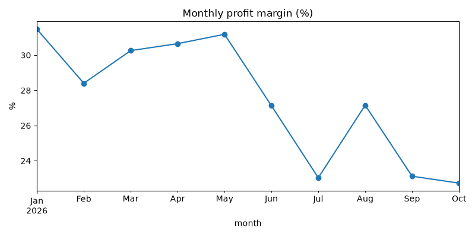
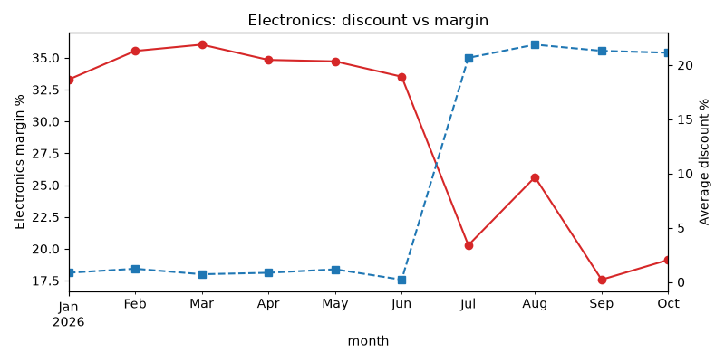
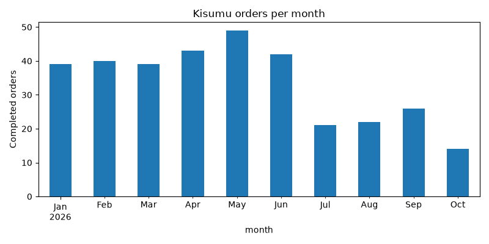

# Jengo Sales Review: January – October 2026

*Draft*

## Summary

From July, profit margin fell from about 30% to about 23%. The drop came with a jump in electronics discounts, from about 1% to about 21%, and those discounts brought no extra sales. Separately, Kisumu's sales fell by about 59% from July, across every category and both sales reps.

---

## Key findings

### 1. Margin fell from about 30% to about 23% from July, at every branch

- Every branch lost between 5 and 12 margin points.
- Profit per month fell by about KES 46k in total.
- The biggest losses per month were **Nakuru** (about 15.8k), **Nairobi** (about 14.6k) and **Kisumu** (about 11.8k).

| Branch | Margin Jan–Jun | Margin Jul–Oct |
|---|---|---|
| Eldoret | 31.5% | 25.0% |
| Kisumu | 28.3% | 23.0% |
| Mombasa | 29.3% | 24.2% |
| Nairobi | 30.2% | 25.2% |
| Nakuru | 30.8% | 19.2% |

### 2. Electronics discounts rose from about 1% to about 21%, and sales did not grow

| Electronics, per month | Jan–Jun | Jul–Oct | Change |
|---|---|---|---|
| Revenue | KES 233,224 | KES 158,565 | about −32% |
| Profit | KES 80,532 | KES 31,765 | about −61% |

- Electronics alone explains the margin drop. Other categories kept an average discount of about 1% in both periods.
- In Nakuru, about 13.4k of the 15.8k monthly profit loss (85%) comes from Electronics. Nakuru's Groceries and Household sales grew.
- At 30% off, a Smart TV 32in (price KES 21,500, cost KES 15,500) sold at a loss of KES 450.

### 3. Kisumu's sales fell about 59% from July, across every category and both reps

- **Completed orders:** 39 to 49 a month from January to June, then 21 in July, 22 in August, 26 in September and 14 in October. This is a sudden drop that has not recovered.
- **Categories:** all four fell. Groceries lost about half its revenue (KES 18,512 → 9,328 a month) without any change in discounts.
- **Sales reps:** both fell by a similar amount.
  - Achieng: KES 26.3k → 9.4k a month
  - Odhiambo: KES 35.3k → 14.4k a month

---

## Recommendations

1. **Review the electronics discount** *(Finding 2)*. Discounts of about 21% came with lower electronics revenue (−32%) and much lower profit (−61%). At 30% off, the Smart TV 32in sells below cost.
2. **Start with Nakuru** *(Findings 1 & 2)*. Nakuru has the largest profit loss of any branch (about 15.8k a month), and 85% of it is Electronics.
3. **Visit Kisumu and talk to the team** *(Finding 3)*. The drop began in July and hit every category and both reps, so it is not one product or one person. The data cannot show what changed at the branch, so the next step is a conversation, not a pricing change.
4. **Track margin by month for each branch and category** *(Finding 1)*. Margin started falling in July. A monthly check by branch and category would show any further change early.

---

## Data notes

### Cleaning log

The raw file had 3,414 rows. After cleaning, 3,254 remained. The figures in this report use the **2,927 completed orders**.

| Step | What was done | Rows affected |
|---|---|---|
| Text labels | Branch, payment method, order status and category spellings were standardised (e.g. 17 branch spellings → 5 branches, 15 payment labels → 4 plus "Unknown") | All rows |
| Prices | "KES" text was removed, and prices were converted to numbers | 340 |
| Zero prices | Replaced with the product's median price | 6 |
| Prices far too high | Prices more than 5× the product's median were replaced with the median (e.g. Rice 5kg at 79,000 vs 790) | 3 |
| Discounts | Written as fractions (10%, 10 and 0.1 all became 0.10). Blanks were set to 0 | 224 blanks |
| Dates | Four date formats were converted to one. Dates of 15 March 2027, after the data period, were set to missing | 5 |
| Quantities | Values of 0, −1 and 999 were set to missing | 25 (92 missing in total) |
| Blank names | Blank customer ID, customer name and sales rep were labelled "Unknown" | 108 / 135 / 170 |
| Duplicates | Repeated orders were removed | 160 |
| Costs | Unit cost was added from the product list. Every product matched | 0 unmatched |

### Assumptions

- A product's median price is a reasonable replacement for a price that is zero or far too high. The true price is not known.
- A blank discount means no discount was given.
- Discount values above 1 (e.g. 10) are percentages.
- Dates such as 05/08/2026 put the day first (5 August).
- Orders with the same order ID and the same details are one order recorded twice.
- Each product has one unit cost for the whole period, taken from the product list.

### Limits

- **Missing quantities:** 77 completed orders have no usable quantity, so they are not in the revenue or profit totals (2,850 of 2,927 orders are counted).
- **Missing dates:** 4 orders have no valid date, so they are not in the monthly charts or the Jan–Jun vs Jul–Oct comparison.
- **Unequal periods:** Jan–Jun is 6 months and Jul–Oct is 4, so the periods are compared **per month**, not as totals.
- **Completed orders only:** returned, cancelled and pending orders are not analysed.
- **Kisumu:** the data shows when and where sales fell, but not why.
